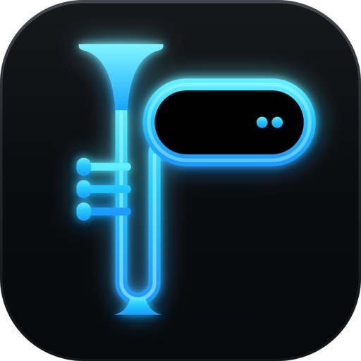

<p align="center">
  
</p>

<h1 align="center">Phemio</h1>
<p align="center"><b>Phemio – Your desktop cameo</b></p>
<p align="center">A Dynamic Island for Windows 11, in one small native app.</p>

<p align="center">
  <a href="https://github.com/nev-minhnh/Phemio/actions/workflows/build.yml"></a>
  <a href="#license"></a>
  
  
</p>

---

Phemio puts a small, live island at the top of your screen (or tucks it into the notch of your taskbar)
that shows what's going on — the song that's playing, the time in two cities, the weather, a timer, a
file you just dropped — and opens into full pages when you hover or click it. It is a single portable
`Phemio.exe` written in Rust with Direct2D: no web engine, no installer, no background services, and
zero CPU while nothing on it moves.

## Highlights

- **Island or notch.** A floating pill, or attached to the top of the screen with flared corners. Pixel
  drift for OLED screens, Always on top, hides for full-screen games and videos.
- **Pages.** Now playing (with album art, controls and seeking), clock and calendar (including the
  Vietnamese lunar calendar), world clock, weather, focus timer, to-do with reminders, a file shelf,
  system controls (volume, brightness, Wi-Fi, Bluetooth), and more. Swipe, scroll, or use ←/→.
- **Search (Alt+S).** Apps, files (through Everything), file contents (Phemio's own index),
  calculations, currency, translations and Gemini answers — right on the island.
- **Link.** One mouse and keyboard across your PCs on the same network, with a shared clipboard and
  file shelf — and one PC's sound on the other's speakers. Paired, end-to-end encrypted, no cloud.
- **Taskbar monitor.** CPU, GPU, memory, disk and network speeds on the taskbar.
- **Transparency.** See-through taskbar and File Explorer backgrounds (clear or frosted), with one
  click to put Windows' own look back.
- **Six languages** besides English: Tiếng Việt, 中文, 한국어, 日本語, Français, Español.
- **Light on memory.** A software Direct2D target into a layered window — no GPU driver DLLs in the
  process; redraws only while something animates.

The [user guide](docs/USER_GUIDE.md) describes every page and setting.

## Download

Get `Phemio-<version>.zip` from [Releases](https://github.com/nev-minhnh/Phemio/releases) (or the
latest build's artifacts under [Actions](https://github.com/nev-minhnh/Phemio/actions)), unzip it
anywhere and run `Phemio.exe`. It's portable: settings live in `%APPDATA%\Phemio`.

Windows SmartScreen may warn because the exe isn't code-signed: **More info → Run anyway**.
Antivirus programs may flag the transparency helper, because it puts code into Explorer to make the
taskbar see-through; it is only used when you switch transparency on.

**Upgrading from DewDrop or Marisland?** Just run Phemio. It asks the old app to quit, moves its
settings and data over, and renames the autostart entry. Your linked PCs stay paired.

## Build from source

Phemio is two crates: `mglass/` (the transparency helper, a DLL) and the app itself, which carries
the DLL inside it. Build the helper first, for the same target.

**On Windows** (Rust with the MSVC toolchain and the Visual Studio Build Tools):

```powershell
cd mglass; cargo build --release; cd ..
cargo build --release
# → target\release\phemio.exe
```

For the app icon and version info to be embedded, `rc.exe` (Windows SDK) must be on `PATH` — for
example, build from a *Developer PowerShell for VS*.

**On Linux, cross-compiling** (this is what the CI does):

```bash
sudo apt install gcc-mingw-w64-x86-64
rustup target add x86_64-pc-windows-gnu
(cd mglass && cargo build --release --target x86_64-pc-windows-gnu)
cargo build --release --target x86_64-pc-windows-gnu
# → target/x86_64-pc-windows-gnu/release/phemio.exe
```

Every push to `main` is built by [GitHub Actions](.github/workflows/build.yml); a tag `v*` also
publishes a release with `Phemio-<version>.zip` (the app) and `Phemio-<version>-source.zip`.

### Translations

The text shown in the app is English in the code (`tr("…")`) and looked up in
`src/i18n_table.rs`, which is generated from `i18n/keys.json` and `i18n/tr_<lang>.json`:

```bash
python3 i18n/missing.py   # strings in the code that have no translation yet
python3 i18n/gen.py       # rebuild src/i18n_table.rs
```

### Developer switches

Environment variables that help testing (they keep their old `ISLET_` prefix):
`ISLET_DUMP=<folder>` writes every frame as raw BGRA, `ISLET_OPEN_PAGE=<n>` opens the island on a
page, `ISLET_OPEN_SETTINGS=<tab>` opens Settings, `ISLET_DEMO_ART=<image>` fakes a playing track,
`ISLET_NET_MOCK=<folder>` serves web lookups from JSON files, `ISLET_FAKE_BATT=pct,charging,saver`
fakes the battery, `ISLET_LINK_NOBEACON=1` tests Link as if broadcasts were blocked, `ISLET_AUDIO_LOG=1` logs how much
sound is waiting on the PC that plays the linked PC's sound.

## Project layout

| Path | What |
|---|---|
| `src/main.rs` | Host window, tray, system events, reminders, weather refresh |
| `src/island/` | The island window, its pages, search, Link page and the mascot |
| `src/settings.rs` | The Settings window |
| `src/gfx.rs` | Drawing (Direct2D, DirectWrite, WIC) and the logo |
| `src/link/` | Link: discovery, pairing and encryption, input sharing, clipboard and shelf, sound to the linked PC, firewall rule |
| `src/tbmon/` | The taskbar monitor |
| `src/glass.rs`, `mglass/` | Transparency: the app side and the helper that runs inside Explorer |
| `src/media.rs`, `audio.rs`, `sysmon.rs`, `bt.rs`, `weather.rs`, `net.rs` | Now playing, sound, system state, Bluetooth, weather, HTTP |
| `src/search.rs`, `contentindex.rs`, `gemini.rs` | Search, the file-content index, Gemini |
| `assets/` | Icon (`phemio.svg` is the source), manifest, version resource |
| `i18n/` | Translations and the table generator |

## Privacy

No accounts, no analytics, no telemetry. Network use happens only for what you ask: weather
(by the city names you type), web searches, translations, currency and Gemini answers (with your own
key), and Link (only between your paired PCs on your local network, encrypted). Details are in the
[user guide](docs/USER_GUIDE.md#privacy).

## Contributing

Issues and pull requests are welcome — see [CONTRIBUTING.md](CONTRIBUTING.md). Security issues:
please follow [SECURITY.md](SECURITY.md) instead of opening a public issue.

## License

Phemio is dual-licensed under either of

- the **Apache License, Version 2.0** ([LICENSE-APACHE](LICENSE-APACHE)), or
- the **MIT license** ([LICENSE-MIT](LICENSE-MIT)),

at your option. Unless you explicitly state otherwise, any contribution intentionally submitted for
inclusion in Phemio by you, as defined in the Apache-2.0 license, shall be dual-licensed as above,
without any additional terms or conditions.

Segoe UI, Segoe Fluent Icons and the other Windows fonts Phemio draws with belong to Microsoft and
are not part of this repository; Phemio uses the copies that come with Windows.
